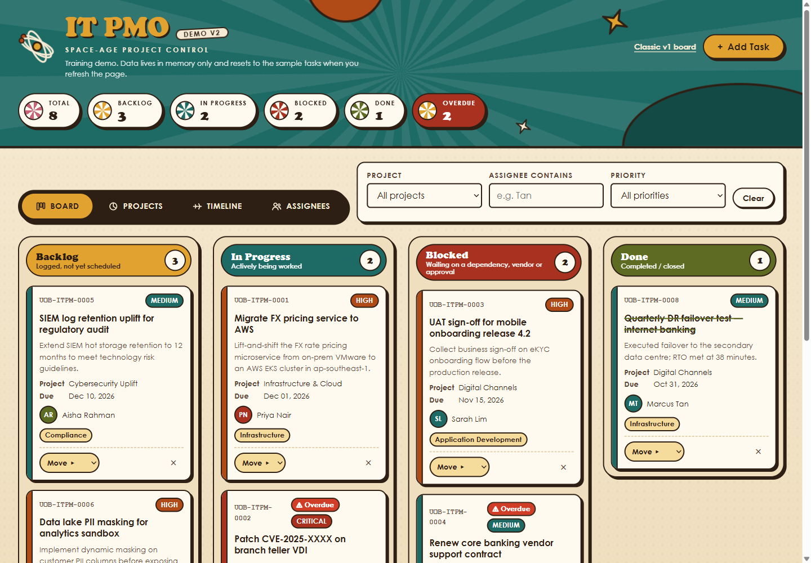
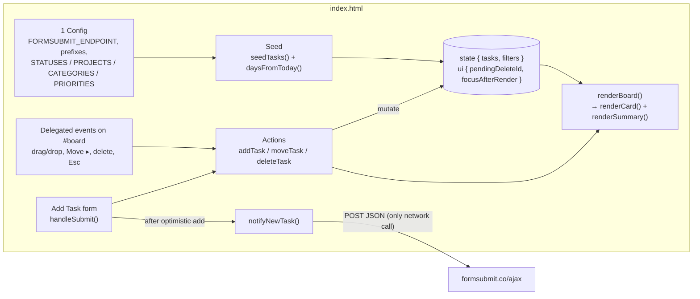

# kanban10

A single-file IT project management Kanban board for a **fictitious** bank's internal IT PMO, built for demos and training.

    [](https://github.com/alfredang/kanban10/actions/workflows/ci.yml) [](https://github.com/alfredang/kanban10/deployments/github-pages)

**Live demo:** https://alfredang.github.io/kanban10/ (classic v1)  
**Retro v2:** https://alfredang.github.io/kanban10/v2/ (1960s space-age redesign, with tabs and hardening)


> **Demo data only.** The eight seeded tasks, people and projects are made up. Board state lives in memory only; refreshing the page resets it to the sample data. Nothing is stored in localStorage, cookies or any other storage API.

## v2: retro redesign ([`v2/index.html`](v2/index.html))



A second single-file page with the same rules and data model as v1, deployed next to it at `/v2/`. v1 is unchanged.

- **Four tabs** (WAI-ARIA tabs with arrow keys and `#board`/`#projects`/`#timeline`/`#people` deep links): the Kanban **Board**; **Projects**, with animated donut dials of the status mix; a **Timeline** of due dates per project with a today line and a T-minus countdown; and **Assignees**, with workload bars per person. The other views link back to the board (filtered, or straight to a card).
- **1960s look:** mustard, teal, orange and avocado on cream, a rotating sunburst, an atom logo, hard offset shadows and bouncy motion. It uses system fonts only, and all motion is off under `prefers-reduced-motion`.
- **Hardening:**
  - **Content Security Policy:** a strict policy with `default-src 'none'`. The inline script and style are allowed only by SHA-256 hash, and `connect-src` allows only formsubmit.co. Dynamic sizes are set through CSSOM, never inline `style`. Run `node tools/csp.mjs v2/index.html --write` after editing the script or style; CI fails if the hashes are stale.
  - **Page settings:** `no-referrer`, `noindex`, and a frame guard against clickjacking.
  - **Input handling:** control and bidi-override characters are stripped. Projects, categories, priorities, statuses and URL hashes are checked against allow-lists, and due dates must be real dates within 5 years. The form has a honeypot field.
  - **FormSubmit requests:** each call is rate-limited (5 per 10 minutes) and times out after 10 s. It sends no credentials and refuses redirects.
  - **Board limits:** at most 200 tasks. Toasts are built with `textContent`.

## Features

- Four columns (Backlog, In Progress, Blocked, Done) with count badges, plus a summary strip (total, per-status counts, overdue).
- Drag and drop between columns (native HTML5), plus a keyboard-accessible **Move ▸** control on every card.
- Priority shown as a coloured left border and a pill; an **Overdue** badge when the due date has passed and the task isn't Done.
- Inline delete confirmation ("Delete? Yes / No"), with no browser `confirm()` dialogs.
- **+ Add Task** modal with 8 fields, inline validation and auto IDs (`UOB-ITPM-0009`, …).
- Filter by project, assignee (contains) and priority.
- Optional email notification for each new task via [FormSubmit](https://formsubmit.co) (see [Configuration](#configuration-email-notifications)).

## Architecture

Everything (markup, `<style>` and `<script>`) lives in one `index.html`. There is no framework, build step or external resource, and the page works from `file://`.



- **Numbered script sections:** config → state → utils → seed → filters → rendering → actions → toasts → FormSubmit → form → board events → filter events → init.
- **Single source of truth:** the in-memory `state = { tasks, filters }`. A separate `ui` object holds transient card UI (pending delete confirmation, focus to restore) so it survives re-renders.
- **Re-render rule:** card DOM is written only by `renderBoard()`. Actions mutate `state` and then re-render; they never patch the DOM directly. Every user string goes through `escapeHtml()` before it reaches `innerHTML`.
- **Delegated events** on `#board`, because cards are recreated on every render.
- **Config-driven:** columns and all `<select>` options are generated from the arrays in the config block.
- **One outbound call:** `notifyNewTask()` posts the new task to FormSubmit. The card is added optimistically before the request, and a failure only shows a warning toast.

```
kanban10/
├── index.html              # the whole app: markup, CSS, JS
├── docs/screenshot.png     # README screenshot
├── .github/workflows/ci.yml
├── .htmlvalidate.json      # html-validate config used by CI
├── CLAUDE.md               # detailed contributor / architecture notes
└── README.md
```

## Running locally

There is no build step and there are no dependencies.

```bash
git clone https://github.com/alfredang/kanban10.git
cd kanban10
start index.html        # Windows
open index.html         # macOS
xdg-open index.html     # Linux
```

Or, if you prefer to serve it over HTTP, run `python -m http.server 8000` and open http://localhost:8000.

## Configuration: email notifications

The config block at the top of the `<script>` in `index.html` contains:

```js
const FORMSUBMIT_ENDPOINT = "https://formsubmit.co/ajax/YOUR_EMAIL@example.com";
const TASK_ID_PREFIX = "UOB-ITPM-";
const EMAIL_SUBJECT_PREFIX = "[UOB IT PMO]";
```

- Replace `YOUR_EMAIL@example.com` with the inbox that should receive new-task emails. This is the only place the address appears.
- **Anything you put here is public** in this repo and on the live site. Use FormSubmit's random-string alias (`https://formsubmit.co/ajax/<hash>`, shown in the activation email) rather than a raw address.
- While the placeholder is still in place, the app **skips the network call** and shows a warning toast. The card is still added.
- FormSubmit sends an **activation email** on the first submission to a new address. Nothing is delivered until you click the link in it. Until then FormSubmit replies `success: "false"`, and the app shows "Card added locally — email notification failed".
- The card is added optimistically, before the request. An email failure never removes it.
- The ID and subject prefixes are constants, so you can rebrand them in one place.

### Making the board persistent

The demo deliberately avoids storage. To persist the board, serialise `state.tasks` to a backend (or `localStorage` for a single-user demo) inside `addTask`, `moveTask` and `deleteTask`, and load it in place of `seedTasks()` at init. Keep `nextId` in sync with the highest stored ID. Note that CI currently fails any use of browser storage, so you'd need to relax that check too.

## CI/CD

A single workflow, [`.github/workflows/ci.yml`](.github/workflows/ci.yml), runs on pushes and pull requests to `main`, and can be started manually:

- **`check`** (every push and PR):
  - Secret scan of the full history with [gitleaks](https://github.com/gitleaks/gitleaks-action).
  - Constraint checks with `grep` on `index.html` and `v2/index.html`. These fail the job on external scripts, stylesheets or `@import`; on `localStorage`/`sessionStorage`/`indexedDB`/`document.cookie`; on `alert(`/`confirm(`; on `!important`; and on any URL host other than `formsubmit.co`.
  - CSP hash check for v2 (`node tools/csp.mjs v2/index.html`).
  - HTML validation of both pages with `npx html-validate@8`, run on the fly, so the repo stays dependency-free. [`.htmlvalidate.json`](.htmlvalidate.json) turns off two rules that conflict with deliberate choices: `wcag/h32` (the filter form filters live, so it has no submit button) and `aria-label-misuse` (the summary `<dl>` is labelled for screen readers).
- **`deploy`** (pushes to `main` only, after `check` passes): stages `index.html` (site root) and `v2/index.html` (`/v2/`) and publishes them to GitHub Pages.

## Security & privacy

- **No storage:** no localStorage, sessionStorage, IndexedDB or cookies. A refresh resets the board.
- **One network call:** when a task is added, `notifyNewTask()` POSTs to `https://formsubmit.co/ajax/…`. It sends only that task's fields (ID, title, description, project, category, assignee, priority, due date, status) plus a submit timestamp and FormSubmit options (`_subject`, `_template`, `_captcha`). It sends no other board state and no browser or device data. With the placeholder endpoint, nothing is sent at all.
- **No third-party resources:** no CDNs, web fonts, analytics or images on the page.
- **Fictitious data:** all tasks, people and projects are invented for training. There is no real bank logo or branding.

## Contributing

- Keep it one file, using vanilla JS, with no CDNs, web fonts or images (the page must work from `file://`).
- Follow the re-render rule and `escapeHtml()` everything (see [Architecture](#architecture)).
- Edit the config arrays, not the markup, to change columns or options.
- Compare dates as local `YYYY-MM-DD` strings. Don't use `toISOString()` for dates.
- Use CSS custom properties from `:root`. No `!important`, no `alert()` / `confirm()`.

There is no automated test suite beyond CI's checks. To verify changes, open the page and run through drag/drop, keyboard move, add (including invalid input), delete and filters. See [CLAUDE.md](CLAUDE.md) for a fuller walkthrough.

## License & credits

No license file has been added yet, so all rights are reserved by the author by default. Email notifications are powered by [FormSubmit](https://formsubmit.co).
