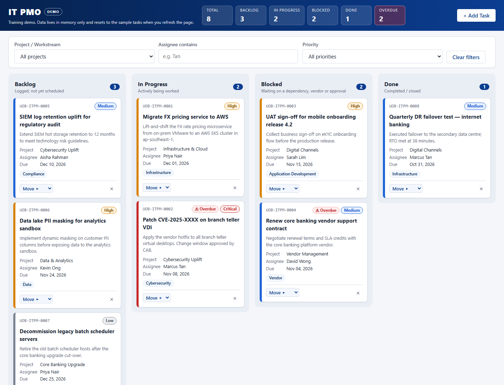

# kanban10

**Live demo:** https://alfredang.github.io/kanban10/

A single-file IT project management Kanban board for a **fictitious** bank's internal IT PMO, built for demos and training. It is plain HTML, CSS and JavaScript in one `index.html`, with no frameworks, build step or external resources.



> **Demo data only.** The eight seeded tasks, people and projects are made up. Board state lives in memory only; refreshing the page resets it to the sample data. Nothing is stored in localStorage, cookies or any other storage API.

## Features

- Four columns (Backlog, In Progress, Blocked, Done) with count badges, plus a summary strip (total, per-status counts, overdue).
- Drag and drop between columns (native HTML5), plus a keyboard-accessible **Move ▸** control on every card.
- Priority shown as a coloured left border and a pill; an **Overdue** badge when the due date has passed and the task isn't Done.
- Inline delete confirmation ("Delete? Yes / No"), with no browser `confirm()` dialogs.
- **+ Add Task** modal with 8 fields, inline validation and auto IDs (`UOB-ITPM-0009`, …).
- Filter by project, assignee (contains) and priority.
- Optional email notification for each new task via [FormSubmit](https://formsubmit.co) (see below).

## Run locally

There is no build. Open `index.html` directly in a browser by double-clicking it, or from a terminal:

```
start index.html        # Windows
open index.html         # macOS
```

## Configuration: email notifications

The config block at the top of the `<script>` in `index.html` contains:

```js
const FORMSUBMIT_ENDPOINT = "https://formsubmit.co/ajax/YOUR_EMAIL@example.com";
const TASK_ID_PREFIX = "UOB-ITPM-";
const EMAIL_SUBJECT_PREFIX = "[UOB IT PMO]";
```

- Replace `YOUR_EMAIL@example.com` with the inbox that should receive new-task emails. This is the only place the address appears.
- While the placeholder is still in place, the app **skips the network call** and shows a warning toast. The card is still added.
- FormSubmit sends an **activation email** on the first submission to a new address. Nothing is delivered until you click the link in it. Until then FormSubmit replies `success: "false"`, and the app shows "Card added locally — email notification failed".
- The card is added optimistically, before the request. An email failure never removes it.
- The ID and subject prefixes are constants, so you can rebrand them in one place.

## Making the board persistent

The demo deliberately avoids storage. To persist the board, serialise `state.tasks` to a backend (or `localStorage` for a single-user demo) inside `addTask`, `moveTask` and `deleteTask`, and load it in place of `seedTasks()` at init. Keep `nextId` in sync with the highest stored ID.

## Deployment

Each push to `main` deploys the repo root to GitHub Pages through [`.github/workflows/pages.yml`](.github/workflows/pages.yml). No build step runs.

## Contributor notes

- Keep it one file, using vanilla JS, with no CDNs, web fonts or images (the page must work from `file://`).
- Card DOM is written only by `renderBoard()`. Actions mutate `state` and then re-render. Every user string goes through `escapeHtml()` before it reaches `innerHTML`.
- Columns and `<select>` options come from the `STATUSES` / `PROJECTS` / `CATEGORIES` / `PRIORITIES` arrays in the config block. Edit those, not the markup.
- Dates are compared as local `YYYY-MM-DD` strings. Don't use `toISOString()` for dates.
- Colours and spacing come from CSS custom properties in `:root`. Don't use `!important`.
- No `alert()` / `confirm()`.
- No real bank logos or branding.

See [CLAUDE.md](CLAUDE.md) for a fuller architecture walkthrough.

## Tests

There is no automated test suite. To verify changes, open the page and run through drag/drop, keyboard move, add (including invalid input), delete and filters.
